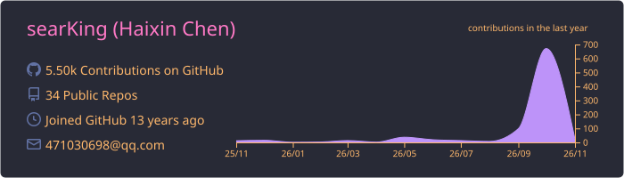
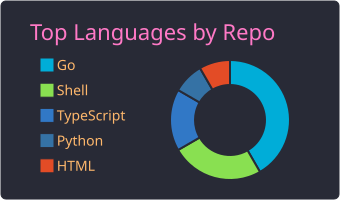
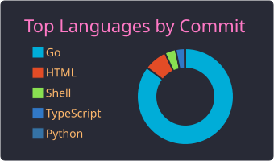
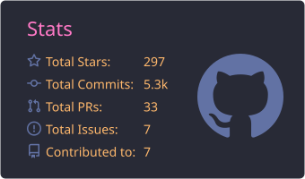
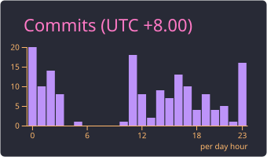

[](https://visitorbadge.io/status?path=https%3A%2F%2Fgithub.com%2FsearKing)

## Tech Stack

| Property         	| Data                                                                               	|
|------------------	|------------------------------------------------------------------------------------	|
| Language         	| Go/Cgo, C/C++, Python, TypeScript, VHDL                                                 |
| Domain Knowledge 	| AI, Linux, FFmpeg, OpenCV, Streaming Media, Kubernetes                                            	|
| Database         	| MySQL, Redis, Sqlite, MongoDB                                                       |
| OS               	| MacOS, CentOS, Windows                                                              |
| Editor           	| GoLand/CLion/PyCharm/Gateway, VsCode, VIM                                                                 |
| Terminal          | Iterm2, Oh My Zsh, Tmux                                                             |

<picture>
  <source media="(prefers-color-scheme: dark)" srcset="https://raw.githubusercontent.com/searKing/searKing/github-contribution-grid-snake-output/github-contribution-grid-snake-dark.svg" />
  <source media="(prefers-color-scheme: light)" srcset="https://raw.githubusercontent.com/searKing/searKing/github-contribution-grid-snake-output/github-contribution-grid-snake.svg" />
  
</picture>

<details>
<summary>GitHub Stats</summary>
  
[](https://github.com/searKing)
[](https://github.com/searKing/golang) [](https://github.com/searKing/golang)
[](https://github.com/searKing/golang) [](https://github.com/searKing/golang)
</details>

<details>
<summary>Wakatime Stats</summary>
<br>
<!--START_SECTION:waka-->

```txt
From: 27 October 2026 - To: 03 November 2026

Total Time: 25 hrs

Go                13 hrs 54 mins        ██████████████░░░░░░░░░░░   55.57 %
Python            3 hrs 23 mins         ███▒░░░░░░░░░░░░░░░░░░░░░   13.57 %
JSON              1 hr 41 mins          █▓░░░░░░░░░░░░░░░░░░░░░░░   06.77 %
C++               1 hr 38 mins          █▓░░░░░░░░░░░░░░░░░░░░░░░   06.58 %
protobuf          1 hr 17 mins          █▒░░░░░░░░░░░░░░░░░░░░░░░   05.19 %
Markdown          51 mins               █░░░░░░░░░░░░░░░░░░░░░░░░   03.45 %
YAML              47 mins               ▓░░░░░░░░░░░░░░░░░░░░░░░░   03.17 %
Protocol Buffer   25 mins               ▒░░░░░░░░░░░░░░░░░░░░░░░░   01.72 %
Swift             22 mins               ▒░░░░░░░░░░░░░░░░░░░░░░░░   01.51 %
C/C               20 mins               ▒░░░░░░░░░░░░░░░░░░░░░░░░   01.34 %
```

<!--END_SECTION:waka-->

</details>

[](https://leetcode.cn/chen-hai-xin-3/)
